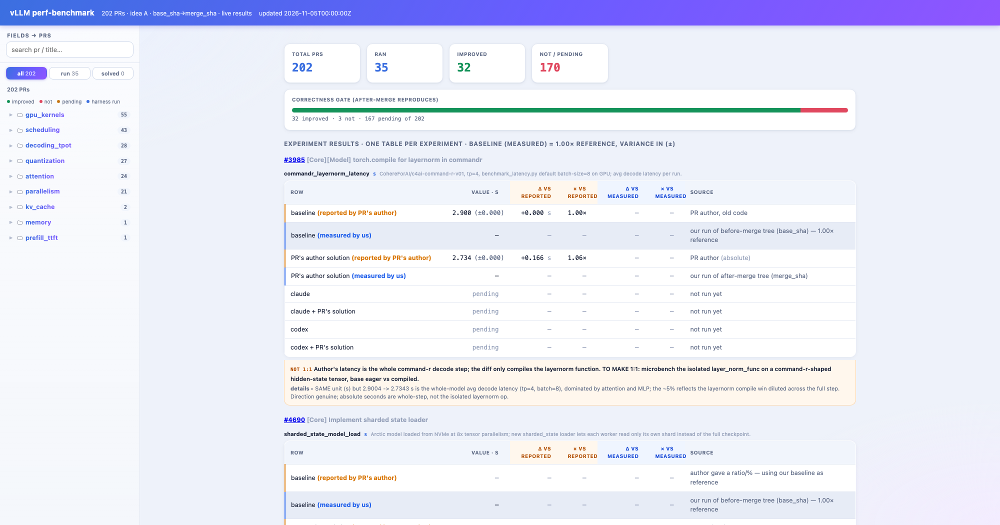
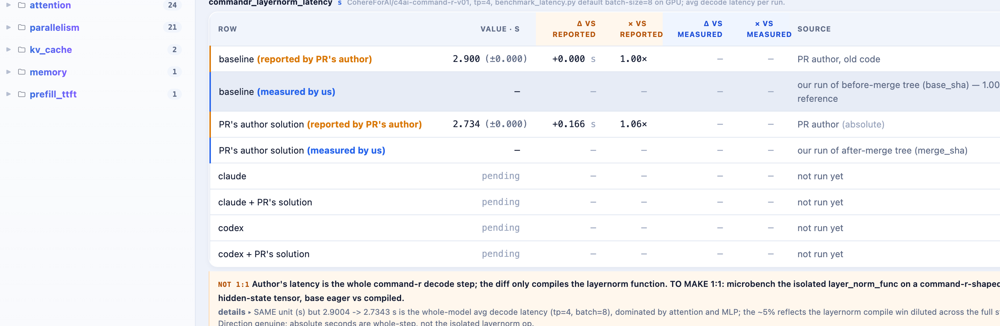

<p align="center"></p>
<p align="center">
<a href="https://station-wsl-michael.taila4786c.ts.net/formula/web/"></a>


</p>

<h3 align="center">202 real vLLM perf PRs, each a benchmark task. Did the PR's speedup reproduce?</h3>
<p align="center">Live dashboard: <a href="https://station-wsl-michael.taila4786c.ts.net/formula/web/">station-wsl-michael.taila4786c.ts.net:10000/formula/web/</a></p>



## Repository layout

**One directory per PR, `data/pr_<n>/`, holds everything about that PR.** Every fact has one
owner file; everything else is regenerated from it. `[raw]` = crawl output, `[hand]` = hand-written,
`[gen: X]` = generated by X (never edit), `[run: X]` = written by a benchmark run.

```
data/pr_<n>/
├── pr.md                      [raw]   the PR conversation (title, body, comments)
├── pr.diff                    [raw]   the merged diff
├── solution.md                [raw]   issue / fix in words / author's words / ground-truth diff
├── task.json                  [hand]  THE experiment definition — catalog (title, date, field, area, hardware,
│                                      base_sha, merge_sha, reported gain), wheel, source_files, test_files, swap,
│                                      repeats, test_note, workload {kind, script, cmd, unit, headline, note},
│                                      experiments [{name, unit, reported {base, patch | pct | delta}, scope notes}],
│                                      hardware_overrides {<hw-slug>: {cmd, repeats, extra_pip, torch_fix, note}};
│                                      its `requirements` block is [gen: gen/gen_requirements.py]
├── bench.py                   [hand]  vendored microbench the workload cmd runs as /task/bench.py   (optional)
├── tests/                     [hand]  extra oracle tests, mounted at /task/tests                    (optional)
├── notes.md                   [hand]  free-form notes, e.g. a pre-pipeline measurement report      (optional)
├── problem.md                 [gen: gen/gen_workloads.py]  solver objective = solution.md (quoted) + task.json experiments
├── workload/
│   ├── default/               [gen: gen/gen_workloads.py]  the generic definition
│   │   ├── Dockerfile         the ONLY image run_one.sh builds — templates/Dockerfile.gpu-wheel rendered with
│   │   │                      the task's wheel, shas, torch_fix, extra_pip (docker build -t vllm-task:<n> <this dir>)
│   │   ├── run_workload.sh    the workload cmd for one arm (ARM env), skips without CUDA
│   │   ├── download.sh        fetch-on-demand weights for the PR's cluster into .weights/<cluster>
│   │   ├── workload.json      canonical experiment description: image, cmd, policy, metrics, reported, reproduced, gap
│   │   └── WORKLOAD.md        the same for humans + docker lines to re-run one arm without run_one.sh
│   └── <hw-slug>/             [gen: gen/gen_workloads.py]  same five files with hardware_overrides[<hw-slug>] applied
├── results.<hw-slug>.json     [run: pipeline/record.py → aggregate.py]  one per hardware the PR was measured on
├── logs/<hw-slug>/            [run: record.py]  arms.json, test/solve/workload logs, machine snapshots  (git-ignored)
└── work/                      [run: run_one.sh]  base_full/, gold_full/, solutions/, wl_*.log scratch  (git-ignored)
```

The **hardware slug** names the machine class a workload / result belongs to:
`python3 pipeline/machine.py slug` → `rtx5070ti`, `h100-80gb`, `cpu` … (`HW_SLUG=` overrides).
`gen_workloads.py` renders `workload/default/` and `workload/<this machine's slug>/`; `run_one.sh`
builds the slug's Dockerfile when present, else `default/`; results and logs are tagged the same way.
The dashboard shows, per PR, the serving machine's slug when it has a result, else the first one, and names it.

Top-level:

```
run/          runFormula.sh (the dispatcher, 6 flags) apply.sh (standalone patch applier: patch -p1 + .bak)
pipeline/     run_one.sh run_workloads.sh health_check.sh (bash) · apply_ai_solutions.py (CPU gate)
              select_prs.py (the one selection rule) record.py parse_workload.py measure.py aggregate.py
              derive.py machine.py requirements.py next_prs.py reproduce_report.py
gen/          layout.py (+layout.sh: the ONE owner of paths) gen_index.py gen_requirements.py gen_workloads.py
              gen_tasks.py conf.py migrate_layout.py
hardware/     validation.py   the GPU gate: needs-GPU + task-hardware match + machine-change confirm
tools/        check_terms.py (terminology lint) serve.py serve.sh (dashboard server)
stats/        build_stats.py stats.ipynb → prs.csv fields.csv status.csv ai_arms.csv gaps.png · hardware.csv (machine ledger)
templates/    Dockerfile.gpu-wheel (the per-PR template) · Dockerfile.gpu-source, Dockerfile.cpu-bench (legacy, unused)
web/          index.html — the live dashboard (reads index.json, results/manifest.json, data/pr_<n>/…)
              header shows one progress bar (no stat cards): total PRs / processed / measured / re-produced /
              re-solved / improved / pending as its legend. Results panel has a PR-number search that only
              SUGGESTS matches as you type; clicking a match pins that PR to the top (above a red divider).
              Each pinned PR has a "−" to unpin it; a right-edge "−" (shown only when something is pinned)
              clears all. Clicking an experiment name folds/unfolds its table.
results/      all.json + manifest.json   [gen: pipeline/aggregate.py]  the web aggregate, nothing else
index.json    202-PR catalog              [gen: gen/gen_index.py from data/pr_*/task.json]
clusters.json config.yaml dict_of_harnesses.json   [hand]  model clusters · knobs · solver arms
runFormula.sh run_one.sh serve.sh   thin root wrappers (exec run/… pipeline/… or tools/…)
.work/        run.lock, vllm_releases.json, queue logs   (git-ignored)
```

Regenerate everything derived (idempotent, no diff on a second run):

```bash
python3 gen/gen_index.py && python3 gen/gen_requirements.py && python3 gen/gen_workloads.py \
  && python3 pipeline/derive.py --all && python3 pipeline/aggregate.py && python3 stats/build_stats.py
python3 tools/check_terms.py          # prose says baseline / PR's solution / reported / reproduced
```

Migrating a checkout that still has the old `tasks/`, `results/<pr>.json`, `.work/pr_<n>/`
layout: `python3 gen/migrate_layout.py` (idempotent; writes `MIGRATION.md`).

## 

Turn merged vLLM perf PRs into reproducible tasks. Pre-merge code = baseline.
Merged code = author's solution. Measure both, side by side, in the PR's own unit.
Check the claimed gain is real.

## 

PR #21222 (block-pool queue ops): author claimed 19×. Our isolated microbench shows
~2× — because the 19× was a whole-engine aggregate, not the one op. Both numbers are
genuine; different scope. The dashboard shows both and names the gap.

## 

FormulaCode. One isolated image per task; baseline vs solution timed back-to-back in
the SAME container (paired A-B-B-A); repeat for a noise distribution; count only gains
that clear a MAD gate.

## 



- 202 PRs catalogued. 40 carry a runnable workload (`task.json:workload.cmd`), 35 of them
  wheel-mode tasks run_one.sh can build. `python3 pipeline/next_prs.py --status` is the live list.
- Key finding: the 202 PRs are **NOT hardware-agnostic** — each targets specific hardware
  (CUDA Triton kernels, FP8, multi-GPU PP/TP). ~10 reproduce on CPU; the rest need the
  author's GPU.
- Honest flags: author numbers are usually a **wider scope** (E2E serving) than our
  isolated op. Every mismatch carries a `NOT 1:1` banner + the exact fix to make it 1:1.
  7 PRs are feature/correctness-only with no real speedup — marked N/A, not faked.
- `stats/prs.csv`, `fields.csv`, `status.csv`, `gaps.png` carry the current numbers.

### GPU box (RTX 5070 Ti, sm_120, wheel mode) — 2026-11-05

Measured in Docker, 5 repeats per arm (mean ± sd), author's own benchmark command.
`claude` = blind (objective without the PR's solution), `claude + PR's solution` = guided.

| PR | metric | baseline | PR's solution | ours | author | claude | claude + PR's solution |
|---|---|---|---|---|---|---|---|
| [#37225](https://github.com/vllm-project/vllm/pull/37225) top-k search | topk_whole b2048 v32k, ms | 1.259 ± 0.003 | 0.958 ± 0.003 | **1.31×** | 1.38× | **0.839 ± 0.166, PASS** (40 min) | **0.778 ± 0.037, PASS** |
| [#33538](https://github.com/vllm-project/vllm/pull/33538) Triton top-k/top-p | topk_whole b16 v32k, ms (10 repeats) | 1.222 ± 0.020 (PyTorch sort) | 0.093 ± 0.029 | **13×** | 4.2× | rerun pending | rerun pending |
| [#41163](https://github.com/vllm-project/vllm/pull/41163) AllPool.forward | median, µs | 120.2 ± 19.7 | 84.4 ± 17.3 | **1.42×** | 1.51× | **12.1 µs, PASS** | 12.1 µs, PASS |
| [#22940](https://github.com/vllm-project/vllm/pull/22940) slot mapping | opt-125m, output tok/s | 2270 ± 12 | 2280 ± 16 | +0.4 % | +2.07 % | 2280, PASS | 2282, PASS |

- #37225: with a 40-minute budget the blind claude arm rewrote the Triton search (611 added
  lines, kernel file only) and beats the PR's solution: 0.839 vs 0.958 ms on top-k, 0.795 vs
  1.590 ms on top-k+top-p; 89 hidden tests pass. With a 15-minute budget it produced nothing.
- #41163: both claude arms beat the PR's solution ~7× by also caching the first-token
  indices on the CPU (no device sync at all); hidden pooling test passes.
- #22940: GPU-bound workload on this box; the slot-mapping CPU gain is inside the noise.
- #33538 baseline = the script's PyTorch sort path (the PR introduces both kernel and script).

## 

Two axes per number: **who** (measured by us / reported by author) × **which code**
(baseline / solution). Four rows per experiment, two colored metric pairs (vs reported,
vs measured), diagonal fill. Full spec: `prompts/numeric_solution.md` (numbers) +
`prompts/benchmark.md` (harness).

## 

`./runFormula.sh` (root wrapper → `run/runFormula.sh`) takes exactly ONE flag. CPU flags are a
compile+apply GATE (apply a patch via `run/apply.sh` → bench → recover from `.bak`; prove it
applies+imports+runs, writing a verdict stamp `results.ai.<arm>.json` — NOT a GPU number). GPU
flags are real measurements that fill `results.<slug>.json` and pass `hardware/validation.py`
first. Runs on Linux (GPU box) and macOS (dev box) — both need docker.

```bash
# CPU gate (any box; apply.sh → run → recover, verdict stamp only, no measurement):
./runFormula.sh --apply-pr-on-cpu 21222            # apply data/pr_<n>/pr.diff
./runFormula.sh --apply-solution-on-cpu 21281 --arm claude   # apply solutions/<arm>/<arm>.patch

# GPU measurement (needs a GPU; blocked on a cpu box or a machine mismatch unless --force):
./runFormula.sh --apply-pr-and-measure-on-gpu 37225 21222    # baseline vs PR's solution
./runFormula.sh --apply-solution-and-measure-on-gpu 37225 --arm claude   # measure a saved solver arm
./runFormula.sh --resolve 37225                    # run the solver to PRODUCE solutions/<arm>/<arm>.patch
./runFormula.sh --run-workloads-on-gpu             # cluster weights, run per-PR workload images

./serve.sh                         # dashboard at http://localhost:8000/web/ (gzip, serves from root)
python3 pipeline/next_prs.py --status        # measured | failed | unmet | pending per workload PR
python3 pipeline/requirements.py 37225       # can THIS machine run it?
DRY_RUN=1 ./run_one.sh 37225                 # print every step, no docker
```

Selection (every flag): give PR numbers → exactly those; give none → the next NOT-yet-processed
PRs of that flow (ascending); add `--force` → the whole set (redo, and override the
hardware-change confirm). No flag → prints usage.

GPU tasks self-skip without CUDA. Weights download on-demand, clustered by model, never
committed. Mixtral (~90 GB) is gated + last.

### 

A CUDA 12.1 source build cannot target newer GPUs (RTX 5070 Ti is sm_120), so every task runs
in **wheel mode**: `data/pr_<n>/task.json` carries `"wheel": "<vllm version>"` = the first PyPI
release after `merge_sha`, and the per-PR `data/pr_<n>/workload/<hw-slug>/Dockerfile`
(rendered by `gen/gen_workloads.py` from `templates/Dockerfile.gpu-wheel`, shas + wheel + pins
baked in) installs that wheel and shallow-clones the PR's own `base_sha` / `merge_sha` trees
**inside the image** (`/base`, `/gold`). `run_one.sh` regenerates that Dockerfile, builds it,
then swaps each arm's `.py` tree over the wheel's site-packages (compiled `.so` stay), runs the
oracle from a vllm-free copy of `tests/`, and times the author's bench command `measure.repeats`
times per arm (`parse_workload.py` → `experiments[]` for the dashboard). Images also carry `gcc`
(Triton JIT) and `tblib` (vLLM `tests/conftest.py`). Every workload dir also carries
`workload.json` + `WORKLOAD.md`: the canonical, self-contained description of that PR's
experiment — image, exact cmd and env, the measurement policy as `run_one.sh` implements it,
metrics, the author's reported numbers and hardware, our reproduced numbers, the
`BASELINE_GAP.md` verdict, and `docker build` / `docker run` lines that re-run one arm without
`run_one.sh`. A workload that must differ per GPU class (engine args, repeats, pins) goes into
`task.json:hardware_overrides[<hw-slug>]`; nothing else changes.

The host needs only docker + the NVIDIA container toolkit.

### 

`formula-dashboard.service` runs `tools/serve.py` on :8000; Tailscale Funnel mounts it at
`https://station-wsl-michael.taila4786c.ts.net/formula/web/`
(`tailscale funnel --bg --https=10000 --set-path /formula http://127.0.0.1:8000`).
The page reads `index.json` once and then only `results/manifest.json` + the per-PR
`data/pr_<n>/results.<hw-slug>.json` files, so the first paint stays small over the slow Funnel link.
